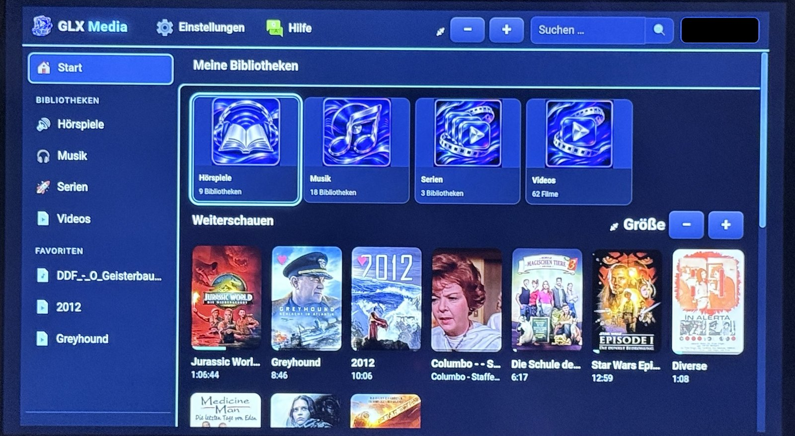
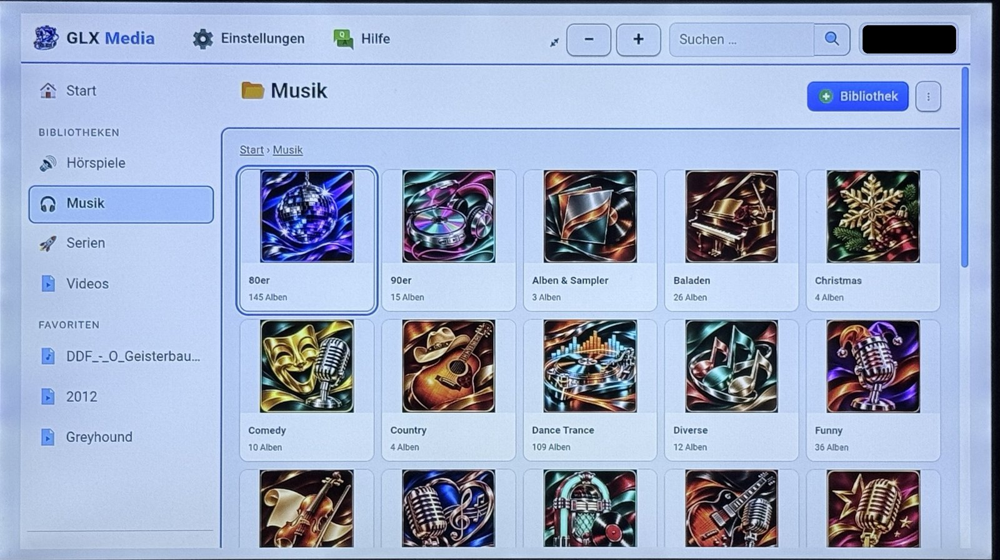
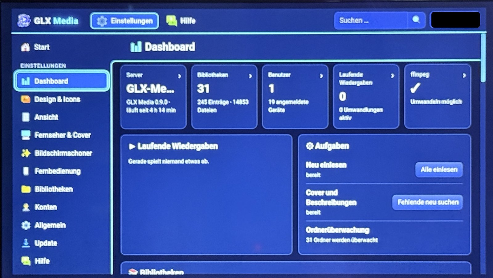
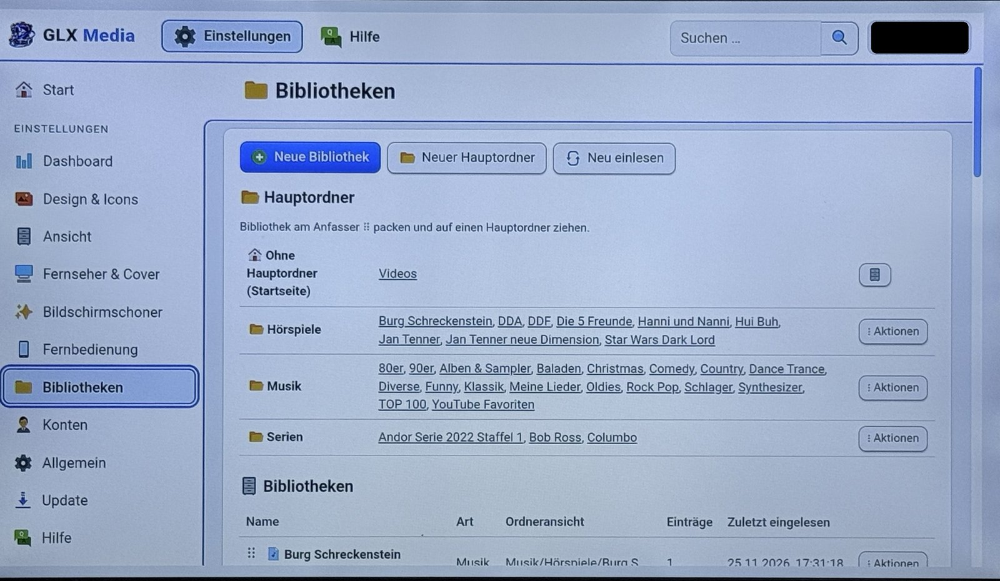
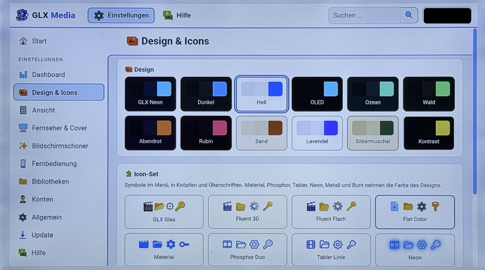

🌍 Sprachen: [🇺🇸 English](README.md) | [🇩🇪 Deutsch](README.de.md)

# 💠 GLX Media Android TV

### GLX Media auf dem Fernseher.

*Die kostenlose App für Android TV und Google TV zum GLX Media Server.* ⚡

   

---

## ⬇️ Download

👉 Neueste Version: [Releases](../../releases/latest)  
👉 Shop und Lizenzen: [glx-tools.de](https://glx-tools.de/product/glx-media-android-tv/)

---

## 📖 Über GLX Media Android TV

### Deine Mediathek auf dem Fernseher

GLX Media Android TV bringt deine Filme, Serien, Musik und Hörspiele vom GLX Media Server auf den Fernseher. Mit Covern, Beschreibungen und Weiterschauen, bedienbar mit dem Steuerkreuz der Fernbedienung.

### Die GLX Media Familie

Das Hauptprogramm ist der GLX Media Server. Er läuft bei dir zu Hause und verwaltet Bibliotheken, Cover, Benutzer und Weiterschauen. Mit einem GLX Media Server nutzt du kostenlos GLX Media Windows für den PC, GLX Media Android TV für den Fernseher, GLX Media Smartphone für das Handy und GLX Remote als Fernbedienung. Auf iPhone und iPad installierst du GLX Media über Safari als Web-App auf dem Home-Bildschirm. Was du auf einem Gerät änderst, siehst du sofort auf allen anderen.

### Alles bleibt synchron

Was du am Fernseher änderst, zum Beispiel Cover, Favoriten oder gesehene Folgen, wird auf dem Server gespeichert und erscheint sofort auch am PC, im Browser und auf dem Handy. Am PC anfangen, am Fernseher weiterschauen.

### GLX Player mit VLC

Filme laufen im GLX Player mit VLC-Abspielmotor, also auch MKV mit AC3- oder DTS-Ton. Tonspur und Untertitel wählst du direkt im Player.

### Neues Player-Bedienfeld

Das Bedienfeld im Player ist schlank und zeigt nur klare Symbole: Titel zurück, Zurückspulen, Play oder Pause, Vorspulen und nächster Titel. Darunter siehst du Position, Restzeit und Gesamtlaufzeit. Der Filmname erscheint nur, wenn du pausierst. Wiederholen und Zufall schaltest du mit einem einzigen Button durch.

### Steuerkreuz wie bei Kodi

Bei laufendem Film spulst du mit links und rechts zurück und vor, mit hoch und runter springst du 10 Minuten vor oder zurück, ganz ohne Menü.

### Weiterschauen und Marker

Im Player setzt du einen Marker an deiner Lieblingsstelle. Beim nächsten Start fragt GLX Media, ob du weiterschauen, ab dem Marker oder von Anfang an abspielen möchtest.

### Musik und Hörspiele

Der Musik- und Hörspiel-Player öffnet sich groß und läuft weiter, während du durch die Bibliothek blätterst.

### GLX Remote: das Handy als Fernbedienung

Mit GLX Remote wird dein Handy zur Fernbedienung: Steuerkreuz, Touchpad, Tastatur, Wiedergabe-Tasten und Sprünge direkt zu deinen Bibliotheken. Für Android gibt es die GLX Remote App, die du direkt in der TV-App unter Einstellungen › Fernbedienung herunterlädst. Auf dem iPhone öffnest du die angezeigte Adresse in Safari, tippst auf Teilen und dann auf „Zum Home-Bildschirm“. Bearbeiten lässt sich die Fernbedienung nur per Doppeltipp, damit nichts aus Versehen verrutscht.

### Einfach verbinden

Die App sucht deinen Server selbst im Heimnetz. Anmelden kannst du dich bequem mit dem Handy per QR-Code. Texte gibst du mit der GLX-Tastatur oder über GLX Remote vom Handy ein.

### Passt auf jeden Fernseher

Größe und Bildrand stellst du direkt in der App ein, damit nichts am Rand abgeschnitten wird. Es gelten die 12 GLX Designs und 10 Icon-Sets, die du in GLX Media eingestellt hast.

### Eigenes Update

Die App aktualisiert sich selbst. Neue Versionen kommen nur von glx-tools.de, mit Prüfsumme.

### Kostenlos

GLX Media Android TV ist kostenlos. Lizenz und Testzeit gibt es nur am GLX Media Server. Für Fernseher ohne Server gibt es die eigenständige App GLX Media TV One.

---

## 📸 Überblick & Screenshots

### 1️⃣ Startseite mit Bibliotheken und Weiterschauen

### 2️⃣ Musik-Bibliothek mit Kacheln (helles Design)

### 3️⃣ Dashboard mit Server, Bibliotheken und Aufgaben

### 4️⃣ Bibliotheken und Hauptordner verwalten

### 5️⃣ 12 Designs und mehrere Icon-Sets

---

## ✨ Funktionen

- 🚀 **Für den Fernseher gemacht:** Große Kacheln, komplett mit der Fernbedienung bedienbar.
- 🧩 **Alle Medien:** Filme, Serien, Musik und Hörspiele von deinem Server.
- ⚙️ **Weiterschauen:** Dort weiterschauen, wo du aufgehört hast, auf jedem Gerät.
- 🔒 **Handy als Fernbedienung:** Funktioniert mit GLX Remote auf dem Android-Handy.
- 📂 **Zwei Sprachen:** Deutsch und Englisch.

---

## 🧩 Systemanforderungen

- Android TV oder Google TV
- Ein laufender GLX Media Server

---

## 🧪 Testzeitraum & Lizenz

Kostenlos. Benötigt einen GLX Media Server.

---

## 🔗 Mehr zu diesem Produkt

👉 [glx-tools.de](https://glx-tools.de/product/glx-media-android-tv/)  
Support: **info@glx-tools.de**

---

## 📄 Lizenz

Copyright © 2026 GLX Tools – Gordon Lehmann. Alle Rechte vorbehalten.  
Dies ist proprietäre kommerzielle Software. Es wird keine Open-Source-Lizenz gewährt. Dieses Repository enthält nur Release-Downloads und Dokumentation; der Quelltext wird nicht veröffentlicht.

---

Mit ❤️ gemacht von **Dreamdancer100**

